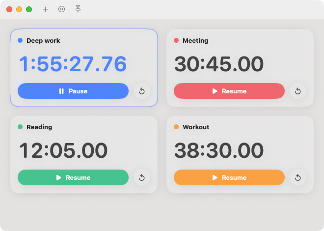
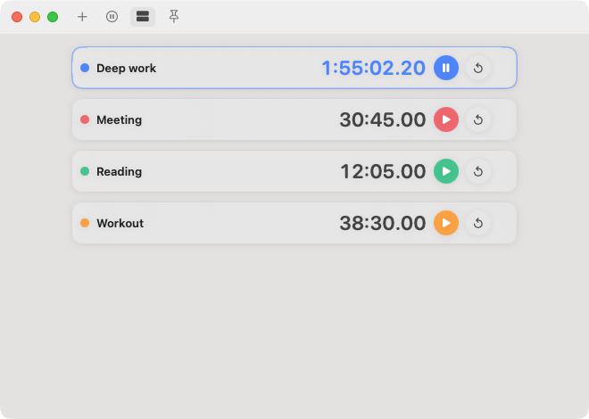

# MultiStopwatch

A small native macOS app for running several stopwatches at once.



Compact cards fit more stopwatches in a small window:



- Add as many stopwatches as you need. Each has a name, a color and its own controls.
- Drag a card to reorder your stopwatches.
- Switch to compact, one-line cards with the toolbar button or Option-Command-C.
- Click a time to start or pause it.
- Right-click a card and choose Set Time… to set the time by hand, with separate hours, minutes and seconds slots.
- Keep the window always on top with the pin button or Shift-Command-T.
- See the running time in the menu bar. Click it for a panel with live times and quick controls.
- Stopwatches survive a restart. A running stopwatch keeps counting while the app is closed.
- The red close button hides the window. Click the app icon to bring it back.

## Install

Download the latest `.dmg` or `.zip` from the [Releases](../../releases) page and move
`MultiStopwatch.app` to your Applications folder.

The app is not notarized, so macOS blocks it the first time. Right-click the app, choose
**Open**, then confirm. You only need to do this once.

## Build from source

Requires macOS 14 or later and the Swift toolchain (Xcode or the Command Line Tools).

```sh
./build.sh && open MultiStopwatch.app
```

`build.sh` builds a release binary and wraps it in `MultiStopwatch.app`. Two options:

- `UNIVERSAL=1` builds for both Apple silicon and Intel.
- `VERSION=1.2.0` sets the app version. Without it, the latest git tag is used.

With only the Command Line Tools installed, the script builds against the 26.5 SDK,
because the newest SDK needs a SwiftUI macro plugin that the tools do not include.

## Releases

Pushing a tag that starts with `v` builds a universal app on GitHub Actions and creates
a draft release with a `.zip` and a `.dmg`. Review the draft on GitHub, then publish it.

```sh
git tag v1.0.0 && git push origin v1.0.0
```

Run the **Release** workflow by hand from the Actions tab to test the build without
publishing. The build is kept as a workflow artifact.

## App icon

`tools/make-icon.swift` draws the icon and writes `Resources/AppIcon.icns`:

```sh
swift tools/make-icon.swift Resources/AppIcon.icns
```
